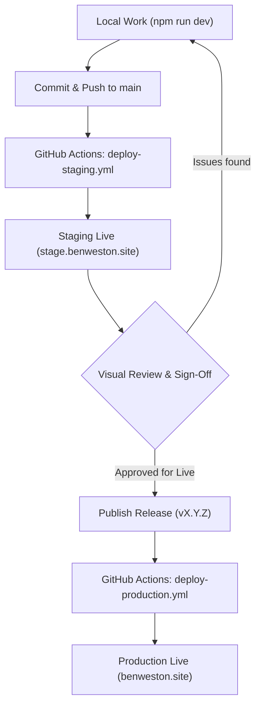

<a href="https://github.com/benweston/app-portfolio">
    
</a>

<div align="justify">

> Codifies the hosting architecture, environment hierarchy, CI/CD automation, and release engineering ruleset for **[benweston.site](https://benweston.site/)**.   

</div>

## Core Principles & Ruleset

1. **The Release IS the Live Site:**   
> [!IMPORTANT]   
> **There must never be a deployment to Production that is not tied to an official version release.** Unversioned or arbitrary commits must never be pushed directly to Live.   

<div align="justify">

2. **Trunk-Based Development:**   

   - The repository operates on a single trunk: `main`.   
   - **Environments are deployment targets, not git branches.** Long-lived `staging` or `production` branches are not maintained.   
   - `main` represents the latest integrated code and continuously deploys to **Staging**.   
   - Production strictly tracks immutable release tags (`v*`).   

</div>

<div align="justify">

3. **Standardised Localisation & Naming:**   

   - All code, copy, documentation, and metadata adhere to **British English (en-GB)** (e.g. *optimised*, *containerised*, *virtualisation*, *licence*).   
   - The cloud provider is always referred to as **Google Cloud** (never "GCP" or "Google Cloud Platform").   

</div>

## Environment Architecture

<div align="justify">

The site uses Firebase Multisite within Google Cloud project `app-portfolio-e0f7f`, deployed across Google's Global Edge CDN:   

| Environment | Target Name | Hosting Site ID | Public URL | Upstream Trigger |
| :--- | :--- | :--- | :--- | :--- |
| **Local Dev** | N/A | N/A | `http://localhost:4321` | `npm run dev` |
| **Staging** | `stage` | `app-portfolio-stage` | [stage.benweston.site](https://stage.benweston.site/) | Any push or merge to `main` |
| **Live (Production)** | `live` | `app-portfolio-e0f7f` | [benweston.site](https://benweston.site/) | Release tag push (`v*`) |
| **Blog (Decoupled)** | External | Hashnode Edge | [blog.benweston.site](https://blog.benweston.site/) | Git push to `benweston/blog-source` |

</div>

### Decoupled Blog Architecture (`blog.benweston.site`)

<div align="justify">

The technical writing hub is intentionally decoupled from `app-portfolio` on its own dedicated subdomain (`blog.benweston.site`), backed by a two-way GitHub pipeline:   

1. **Git-Driven Publishing & Backup:**   
   - **Outbound Source (`benweston/blog-source`):** Markdown articles with YAML frontmatter are authored in Git and published automatically to Hashnode via GitHub Actions.   
   - **Inbound Backup (`benweston/blog-backup`):** Hashnode's GitHub integration synchronises published posts back to a dedicated backup repository.   
2. **Edge Redirection (`/blog`):**   
   - `firebase.json` configures an HTTP `301` edge redirect for `/blog` and `/blog/**` pointing to `https://blog.benweston.site` on both `live` and `stage` hosting targets.   
   - `astro.config.mjs` mirrors this `301` redirect for `/blog` during local development (`npm run dev`).   
3. **Squarespace DNS Configuration:**   
   - **`CNAME` Record:** Host `blog` → `hashnode.network`.   
   - **`TXT` Verification Record:** Host `_vercel` → `vc-domain-verify=blog.benweston.site,...` (verifies domain ownership on Hashnode's underlying edge router).   
4. **Future Transition Path (`app-blog`):**   
   - Because all articles live as standard Markdown with YAML frontmatter in `blog-source` and `blog-backup`, migrating to a self-hosted Astro application (`app-blog` on Firebase Hosting) requires zero content rewriting — only repointing the `blog` DNS record to a new Firebase Hosting target.   

</div>

## Delivery Lifecycle



## CI/CD Automation Pipelines (GitHub Actions)

<div align="justify">

All deployments run via GitHub Actions authenticated using Google Cloud service account `github-actions-deployer` with fine-grained **Firebase Hosting Admin** permissions (`FIREBASE_SERVICE_ACCOUNT` secret).   

</div>

### 1. PR Gatekeeper (`.github/workflows/ci.yml`)

<div align="justify">

- **Trigger:** Pull Requests targeting `main`.   
- **Tasks:**   
  - Installs dependencies (`npm ci`).   
  - Runs Astro static diagnostics (`npx astro check`).   
  - Verifies production compilation (`npm run build`).   
- **Purpose:** Prevents broken code, missing imports, or typing errors from ever merging into `main`. Requires zero cloud secrets.   

</div>

### 2. Continuous Staging (`.github/workflows/deploy-staging.yml`)

<div align="justify">

- **Trigger:** Push or merge to `main`.   
- **Tasks:**   
  - Executes type-checking and compiles static assets into `dist/`.   
  - Authenticates to Google Cloud.   
  - Executes `npx firebase deploy --only hosting:stage`.   
- **Purpose:** Ensures `stage.benweston.site` is an always-fresh, living preview of the latest commit on `main`.   

</div>

### 3. Production Release (`.github/workflows/deploy-production.yml`)

<div align="justify">

- **Trigger:** Tag push matching `v*` (e.g. `v2.0.0`), or manual `workflow_dispatch`.   
- **Tasks:**   
  - Compiles fresh static assets into `dist/`.   
  - Authenticates to Google Cloud.   
  - Executes `npx firebase deploy --only hosting:live`.   
- **Purpose:** Promotes verified staging code to the live domain.   

</div>

### 4. Automated Wiki Synchronisation (`.github/workflows/sync-wiki.yml`)

<div align="justify">

- **Trigger:** Push to `main` modifying `docs/wiki/**`, or manual `workflow_dispatch`.   
- **Tasks:**   
  - Clones `benweston/app-portfolio.wiki.git` using the ephemeral `GITHUB_TOKEN` (`permissions: contents: write`).   
  - Mirrors all canonical Markdown files from `docs/wiki/*.md` into the Wiki repository.   
  - Commits and pushes any changes to `master`.   
- **Purpose:** Guarantees the live GitHub Wiki tab remains continuously synchronised with `docs/wiki/` in the main repository without requiring manual dual-repo commits or extra Personal Access Tokens.   

</div>

## Step-by-Step Developer Workflows

### Scenario A: Day-to-Day Development & Feature Iteration

<div align="justify">

1. Work on `main` (or create a short-lived branch `git checkout -b feat/my-feature`).   
2. Verify locally:   
   ```bash
   npx astro check
   npm run dev
   ```
3. Commit and push:   
   ```bash
   git commit -m "feat: describe the change"
   git push origin main
   ```
4. **Inspect on Staging:** Open [stage.benweston.site](https://stage.benweston.site/) to review the changes live on Google's Edge CDN.   

</div>

### Scenario B: Promoting to Production (Cutting a Release)

<div align="justify">

Once changes on `stage.benweston.site` have been visually inspected and approved:   

</div>

#### Step 1: Bump the Version

<div align="justify">

Update `package.json` and `package-lock.json` to the target Semantic Version:   
```bash
npm version <x.y.z> --no-git-tag-version
git add package.json package-lock.json
git commit -m "chore(release): bump version to <x.y.z>"
git push origin main
```

</div>

#### Step 2: Publish the GitHub Release

<div align="justify">

1. Navigate to **Releases → Draft a new release**.   
2. **Tag:** Enter `v<x.y.z>` (select *Create new tag on publish*).   
3. **Target:** `main`.   
4. **Title:** `v<x.y.z> - <Short Summary>`.   
5. **Description:** Use the standard three-tier template:   

```markdown
## Highlights
- Key user-facing updates, new pages, or major architectural milestones.

## Key Focus Areas
- Deep-dive technical changes across Linux, DX, Cloud, or CI/CD.

## Next Steps
- Planned follow-up tasks and roadmap items.
```

6. Click **Publish release**.   
7. GitHub Actions will detect the tag and automatically deploy `v<x.y.z>` to **[benweston.site](https://benweston.site/)**.   

</div>

### Scenario C: Emergency Rollbacks

<div align="justify">

If an unexpected regression is detected on production:   

1. **Option 1 (GitHub UI):** Go to **Actions → Deploy to Production → Run workflow**, select the previous stable tag (e.g. `v0.1.0`), and trigger the run.   
2. **Option 2 (CLI Fallback):**   
   ```bash
   git checkout v<previous-stable-tag>
   npm run build
   npx firebase deploy --only hosting:live
   ```

</div>

## Manual CLI Fallbacks

<div align="justify">

If GitHub Actions is unavailable, manual deployments can be executed locally from the repository root:   

```bash
# Deploy directly to Staging
npm run build
npx firebase deploy --only hosting:stage

# Deploy directly to Live
npm run build
npx firebase deploy --only hosting:live
```

</div>
