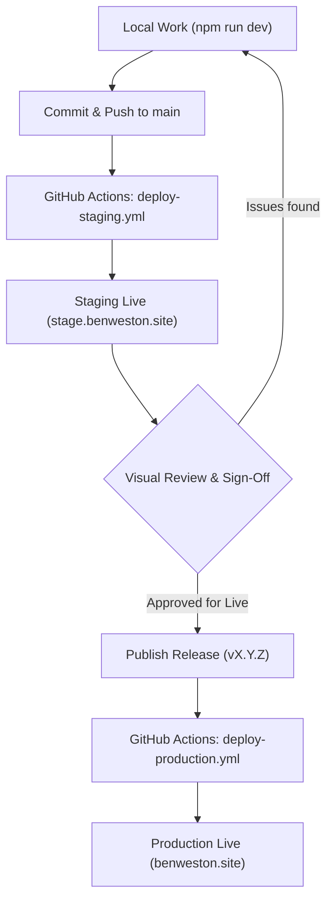

# 02 Operations Guide: Deployment & Release Workflow

This document codifies the hosting architecture, environment hierarchy, CI/CD automation, and release engineering ruleset for **[benweston.site](https://benweston.site/)**.

---

## 🏛️ Core Principles & Ruleset

1. **The Release IS the Live Site:**
   > [!IMPORTANT]
   > **There must never be a deployment to Production that is not tied to an official version release.** Unversioned or arbitrary commits must never be pushed directly to Live.

2. **Trunk-Based Development:**
   - The repository operates on a single trunk: `main`.
   - **Environments are deployment targets, not git branches.** We do not maintain long-lived `staging` or `production` branches.
   - `main` represents the latest integrated code and continuously deploys to **Staging**.
   - Production strictly tracks immutable release tags (`v*`).

3. **Standardised Localisation & Naming:**
   - All code, copy, documentation, and metadata adhere to **British English (en-GB)** (e.g. *optimised*, *containerised*, *virtualisation*, *licence*).
   - The cloud provider is always referred to as **Google Cloud** (never "GCP" or "Google Cloud Platform").

---

## 🌐 Environment Architecture

The site uses Firebase Multisite within Google Cloud project `app-portfolio-e0f7f`, deployed across Google's Global Edge CDN:

| Environment | Target Name | Hosting Site ID | Public URL | Upstream Trigger |
| :--- | :--- | :--- | :--- | :--- |
| **Local Dev** | N/A | N/A | `http://localhost:4321` | `npm run dev` |
| **Staging** | `stage` | `app-portfolio-stage` | [stage.benweston.site](https://stage.benweston.site/) | Any push or merge to `main` |
| **Live (Production)** | `live` | `app-portfolio-e0f7f` | [benweston.site](https://benweston.site/) | Release tag push (`v*`) |

---

## 🔄 Delivery Lifecycle



---

## 🤖 CI/CD Automation Pipelines (GitHub Actions)

All deployments run via GitHub Actions authenticated using Google Cloud service account `github-actions-deployer` with fine-grained **Firebase Hosting Admin** permissions (`FIREBASE_SERVICE_ACCOUNT` secret).

### 1. PR Gatekeeper (`.github/workflows/ci.yml`)
- **Trigger:** Pull Requests targeting `main`.
- **Tasks:**
  - Installs dependencies (`npm ci`).
  - Runs Astro static diagnostics (`npx astro check`).
  - Verifies production compilation (`npm run build`).
- **Purpose:** Prevents broken code, missing imports, or typing errors from ever merging into `main`. Requires zero cloud secrets.

### 2. Continuous Staging (`.github/workflows/deploy-staging.yml`)
- **Trigger:** Push or merge to `main`.
- **Tasks:**
  - Executes type-checking and compiles static assets into `dist/`.
  - Authenticates to Google Cloud.
  - Executes `npx firebase deploy --only hosting:stage`.
- **Purpose:** Ensures `stage.benweston.site` is an always-fresh, living preview of the latest commit on `main`.

### 3. Production Release (`.github/workflows/deploy-production.yml`)
- **Trigger:** Tag push matching `v*` (e.g. `v0.2.0`), or manual `workflow_dispatch`.
- **Tasks:**
  - Compiles fresh static assets into `dist/`.
  - Authenticates to Google Cloud.
  - Executes `npx firebase deploy --only hosting:live`.
- **Purpose:** Promotes verified staging code to the live domain.

---

## 🛠️ Step-by-Step Developer Workflows

### Scenario A: Day-to-Day Development & Feature Iteration

1. Work on `main` (or create a short-lived branch `git checkout -b feat/my-feature`).
2. Verify locally:
   ```bash
   npx astro check
   npm run dev
   ```
3. Commit and push:
   ```bash
   git commit -m "feat: describe the change"
   git push origin main
   ```
4. **Inspect on Staging:** Open [stage.benweston.site](https://stage.benweston.site/) to review the changes live on Google's Edge CDN.

---

### Scenario B: Promoting to Production (Cutting a Release)

Once changes on `stage.benweston.site` have been visually inspected and approved:

#### Step 1: Bump the Version
Update `package.json` and `package-lock.json` to the target Semantic Version:
```bash
npm version <x.y.z> --no-git-tag-version
git add package.json package-lock.json
git commit -m "chore(release): bump version to <x.y.z>"
git push origin main
```

#### Step 2: Publish the GitHub Release
1. Navigate to **Releases → Draft a new release**.
2. **Tag:** Enter `v<x.y.z>` (select *Create new tag on publish*).
3. **Target:** `main`.
4. **Title:** `v<x.y.z> - <Short Summary>`.
5. **Description:** Use the standard three-tier template:

```markdown
## Highlights
- Key user-facing updates, new pages, or major architectural milestones.

## Key Focus Areas
- Deep-dive technical changes across Linux, DX, Cloud, or CI/CD.

## Next Steps
- Planned follow-up tasks and roadmap items.
```

6. Click **Publish release**.
7. GitHub Actions will detect the tag and automatically deploy `v<x.y.z>` to **[benweston.site](https://benweston.site/)**.

---

### Scenario C: Emergency Rollbacks

If an unexpected regression is detected on production:

1. **Option 1 (GitHub UI):** Go to **Actions → Deploy to Production → Run workflow**, select the previous stable tag (e.g. `v0.1.0`), and trigger the run.
2. **Option 2 (CLI Fallback):**
   ```bash
   git checkout v<previous-stable-tag>
   npm run build
   npx firebase deploy --only hosting:live
   ```

---

## 💻 Manual CLI Fallbacks

If GitHub Actions is unavailable, manual deployments can be executed locally from the repository root:

```bash
# Deploy directly to Staging
npm run build
npx firebase deploy --only hosting:stage

# Deploy directly to Live
npm run build
npx firebase deploy --only hosting:live
```
