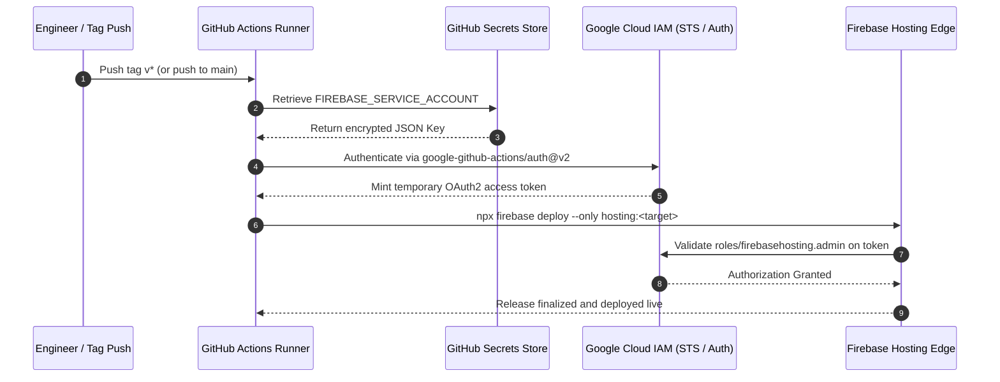

# 04 IAM Model & Security Architecture

This document specifies the identity and access management (IAM) model, service account architecture, and least-privilege security controls governing **[benweston.site](https://benweston.site/)**.

---

## 🛡️ Security Architecture & Principles

The security model is designed around three core tenets:
1. **Principle of Least Privilege (PoLP):** Automated pipelines receive strictly the minimal permissions required to deploy static assets to Firebase Hosting, with zero administrative or cross-service privileges.
2. **Zero Hardcoded Secrets:** No API keys, tokens, or service account credentials are stored in git repositories or static builds.
3. **Traceable Audit Logging:** All deployment actions and releases are logged within Google Cloud Cloud Audit Logs and GitHub Actions audit trails.

---

## 👥 User Access & Identity

| Identity | Platform | Role / Privilege | Scope | Purpose |
| :--- | :--- | :--- | :--- | :--- |
| **Project Owner** | Google Cloud | `roles/owner` | Project `app-portfolio-e0f7f` | Complete project administration and billing management. |
| **benweston** | GitHub | Repository Administrator | Repository `app-portfolio` | Code merges, release publishing, repository secret management. |

---

## 🤖 Service Account Architecture

A dedicated Google Cloud service account is provisioned specifically for GitHub Actions:

- **Service Account Name:** `github-actions-deployer`
- **Email:** `github-actions-deployer@app-portfolio-e0f7f.iam.gserviceaccount.com`
- **Assigned IAM Role:** **Firebase Hosting Admin** (`roles/firebasehosting.admin`)

```bash
# Role verification via gcloud CLI
gcloud projects get-iam-policy app-portfolio-e0f7f \
  --flatten="bindings[].members" \
  --filter="bindings.members:github-actions-deployer@app-portfolio-e0f7f.iam.gserviceaccount.com"
```

### Why `roles/firebasehosting.admin`?
- **Permitted Operations:** Create new releases, upload static files to Hosting buckets, finalize release manifests, and release to hosting targets (`live` and `stage`).
- **Denied Operations:** Cannot modify Google Cloud IAM policies, create or delete GCP projects, access Cloud Storage buckets outside hosting, or modify billing.

---

## 🔐 Secret Management

Authentication credentials are encrypted using GitHub Repository Secrets:

| Secret Name | Location | Format | Permitted Workflows |
| :--- | :--- | :--- | :--- |
| **`FIREBASE_SERVICE_ACCOUNT`** | GitHub Actions Encrypted Secrets | JSON Service Account Key | `deploy-staging.yml`, `deploy-production.yml` |

> [!NOTE]
> The PR validation workflow (`ci.yml`) does **not** have access to `FIREBASE_SERVICE_ACCOUNT`, ensuring untrusted pull requests cannot exfiltrate credentials or trigger unauthorized deployments.

---

## 🔄 End-to-End Authentication Flow


